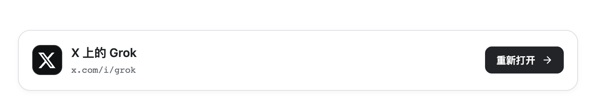

# Codex X Launcher

在 macOS 版 Codex 的左侧栏加一个 **X** 入口。点击后，[X 上的 Grok](https://x.com/i/grok) 会在 Codex 内置浏览器中打开，可以和当前对话并排使用。



## 快速开始

需要 macOS、支持内置浏览器和插件的 Codex 桌面版，以及 Node.js 22 或更高版本和 npm。终端里的 `codex plugin --help` 应能列出 `add` 和 `marketplace`。

```sh
git clone https://github.com/yuanxiangxie/codex-x-launcher.git
cd codex-x-launcher
npm ci
npm run build
codex plugin marketplace add "$PWD"
codex plugin add ai-consult@local-ai-consult
```

打开 Codex，点击左侧栏的 **X**。首次使用时，如果 Grok 要求登录，直接在打开的 X 页面完成登录即可。请保留克隆目录，Codex 将它用作本地插件市场。

<details>
<summary>终端找不到 <code>codex plugin</code>？</summary>

如果桌面应用安装在 `/Applications/ChatGPT.app`，可先在当前终端运行下面这行，使用应用随附的 CLI，再执行上面的两条 `codex plugin` 命令。

```sh
codex() { "/Applications/ChatGPT.app/Contents/Resources/codex-cli/bin/codex" "$@"; }
```

</details>

## 使用

- **重新打开网页**　关闭 Grok 标签后，点击卡片上的「重新打开」。如果打开失败，点击「重试」。
- **展开浏览器**　在浏览器工具栏选择 **Enter full view**，选择 **Exit full view** 可返回分屏。如果悬浮聊天框遮住网页，可在 **⋯** 菜单中选择 **Hide composer**。

## 更新与卸载

在克隆目录中运行以下命令，获取最新源码并更新本机安装。

```sh
git pull --ff-only
npm ci
npm run build
codex plugin add ai-consult@local-ai-consult
```

如果 Codex 仍显示旧卡片，重新载入窗口并再次点击 **X**。要卸载插件并移除本地市场，运行以下命令。

```sh
codex plugin remove ai-consult@local-ai-consult
codex plugin marketplace remove local-ai-consult
```

## 开发

插件通过本地 MCP 服务注册全局侧栏入口。卡片进入视口后才请求打开 Grok，避免 Codex 在后台预加载卡片时意外打开网页。服务通过 macOS 把目标网址交给 Codex，登录和网页交互都在内置浏览器中完成。

- **入口与导航**由 MCP 服务实现。[server.cjs](plugins/ai-consult/server.cjs)
- **卡片样式与交互**分别在 HTML 模板和浏览器脚本中维护。[launcher.html](plugins/ai-consult/launcher.html) · [launcher.js](plugins/ai-consult/launcher.js)

修改源码后重新构建，再运行测试。

```sh
npm run build
npm test          # 验证侧栏入口、图标、卡片资源和激活事件
npm run test:ui   # 使用本机 Google Chrome 验证布局、主题和键盘重试
```

## 许可证

[MIT](LICENSE)
