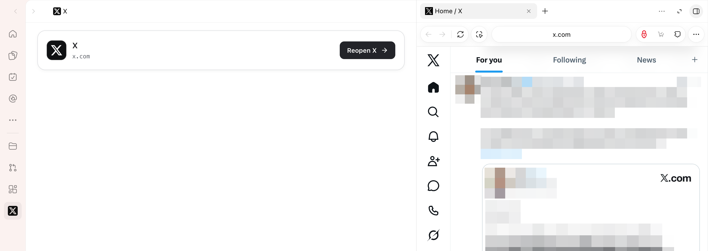
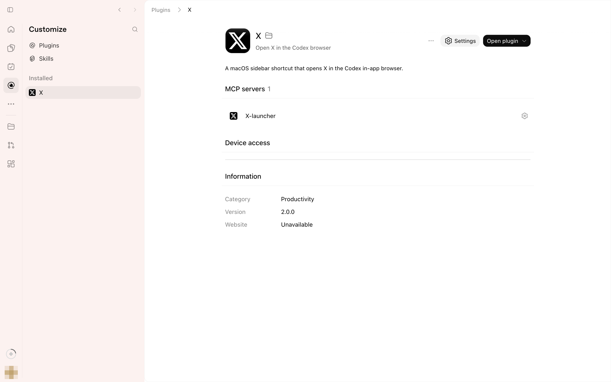
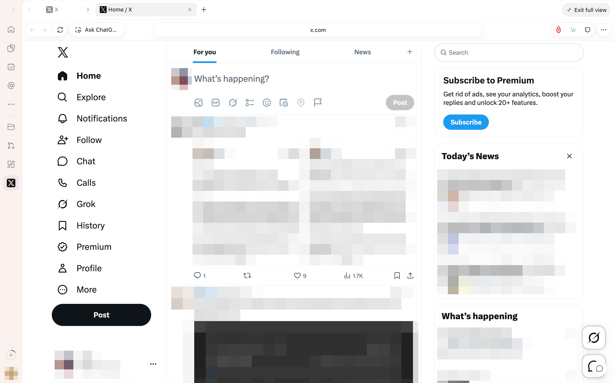

<h1 align="center">Codex X Launcher</h1>

<p align="center"><strong>English</strong> · <a href="README.zh-CN.md">简体中文</a></p>

<p align="center">
  <a href="https://github.com/yuanxiangxie/codex-x-launcher/stargazers"></a>
  <a href="LICENSE"></a>
  <a href="https://github.com/yuanxiangxie/codex-x-launcher/commits/master/"></a>
  <a href="#1-quick-start"></a>
  <a href="#1-quick-start"></a>
  <a href="https://github.com/yuanxiangxie/codex-x-launcher/pulls"></a>
</p>

<p align="center">
  <a href="resources/x-bar.png"></a>
</p>

Codex X Launcher is an open-source sidebar plugin for browsing X while your agent works. For example, you can check whether Tibo has posted about a usage limit reset.

## 1. Quick start

### 1.1 Requirements and installation

You'll need Git, Node.js 22 or later with npm, and Codex for macOS with sidebar plugins and the built-in browser. Tested with Codex `26.1120.50957`. Other versions with those features may work but haven't been tested.

```sh
git clone https://github.com/yuanxiangxie/codex-x-launcher.git
cd codex-x-launcher
npm ci
npm run build
codex plugin marketplace add "$PWD"
codex plugin add x-launcher@codex-x-launcher
```

<details>
<summary>CLI missing the plugin commands?</summary>

If your installation includes the CLI at the path below, use it in the current shell. Look for `add` and `marketplace` in the help output.

```sh
codex() { "/Applications/ChatGPT.app/Contents/Resources/codex-cli/bin/codex" "$@"; }
codex plugin --help
```

</details>

### 1.2 Pin X to the sidebar

| Open X | Pin the shortcut (optional) |
| --- | --- |
| **Customize → Plugins → Installed → X → Open plugin** | On the plugin page, choose **⋯ → Pin to sidebar**. |
| [](resources/x-plugin.png) | [](resources/x-plugin-sidebar.png) |

## 2. Usage

Select **X** in the sidebar to open [x.com](https://x.com/). Sign in and browse X as you would in any browser.

### 2.1 Full view

1. Click **Enter full view** at the top right of the browser pane, or press <kbd>⇧</kbd> + <kbd>⌘</kbd> + <kbd>F</kbd>.
2. Click **Exit full view** to return to split view.
3. For an unobstructed view of X, we recommend choosing **⋯ → Hide composer** if the option is available.

[](resources/x-fullview.png)

## 3. How it works

When the card appears, a local MCP tool passes the fixed `https://x.com/` address to Codex. Its built-in **Chromium** browser renders the page. [Launcher code](plugins/x-launcher/open-x.cjs)

You sign in on X, and the Codex browser manages session cookies. The launcher does not read passwords, cookies, messages, or timeline content. If you ask Codex to use the page, its [browser permissions](https://developers.openai.com/codex/app/browser) apply.

## 4. Update and uninstall

**Update** from the original checkout. Reload the Codex window if the old card is still visible.

```sh
git pull --ff-only
npm ci
npm run build
codex plugin add x-launcher@codex-x-launcher
```

**Uninstall**

```sh
codex plugin remove x-launcher@codex-x-launcher
codex plugin marketplace remove codex-x-launcher
```

## 5. Adapt the launcher to another website

To launch another site, change the destination in your fork of [open-x.cjs](plugins/x-launcher/open-x.cjs). For the Python docs, use this URL.

```js
url.searchParams.set("url", "https://docs.python.org/3/");
```

- Give the fork its own [plugin](plugins/x-launcher/.codex-plugin/plugin.json) and [marketplace](.agents/plugins/marketplace.json) IDs so it can run alongside X. Rename the server in [.mcp.json](plugins/x-launcher/.mcp.json) and [server.cjs](plugins/x-launcher/server.cjs). Set a distinct card URI and match tool names in [launcher.js](plugins/x-launcher/launcher.js).
- Update the display name, button labels, [plugin icon](plugins/x-launcher/x-icon.png), and logo in the [card template](plugins/x-launcher/launcher.html). Adjust the expected URL and labels in the [plugin tests](scripts/verify.mjs) and [UI tests](scripts/verify-ui.mjs).

Build the fork and install it using its new `plugin-name@marketplace-name`.

## Star History

<a href="https://www.star-history.com/?repos=yuanxiangxie%2Fcodex-x-launcher&amp;type=date&amp;legend=top-left">
  <picture>
    <source media="(prefers-color-scheme: dark)" srcset="https://api.star-history.com/chart?repos=yuanxiangxie/codex-x-launcher&amp;type=date&amp;theme=dark&amp;legend=top-left">
    
  </picture>
</a>

## License

The [MIT License](LICENSE) permits commercial use, modification, and redistribution with the copyright and permission notices intact.
