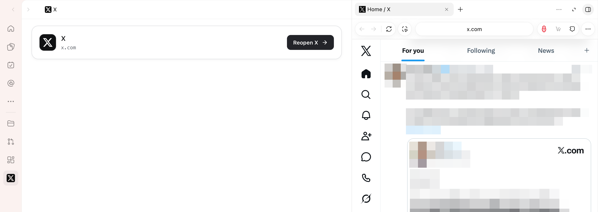
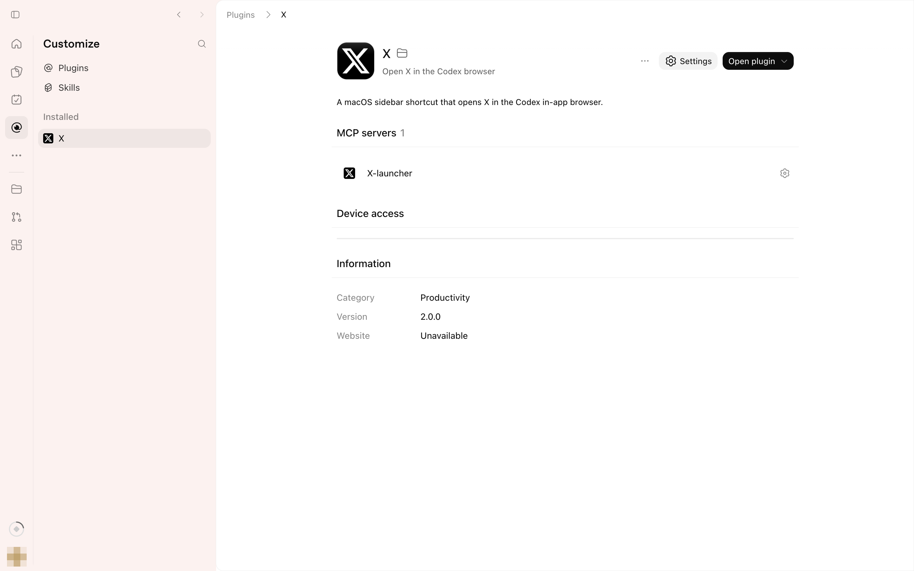
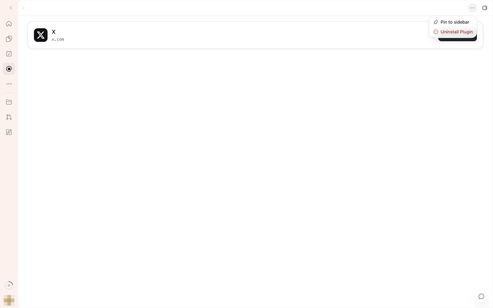
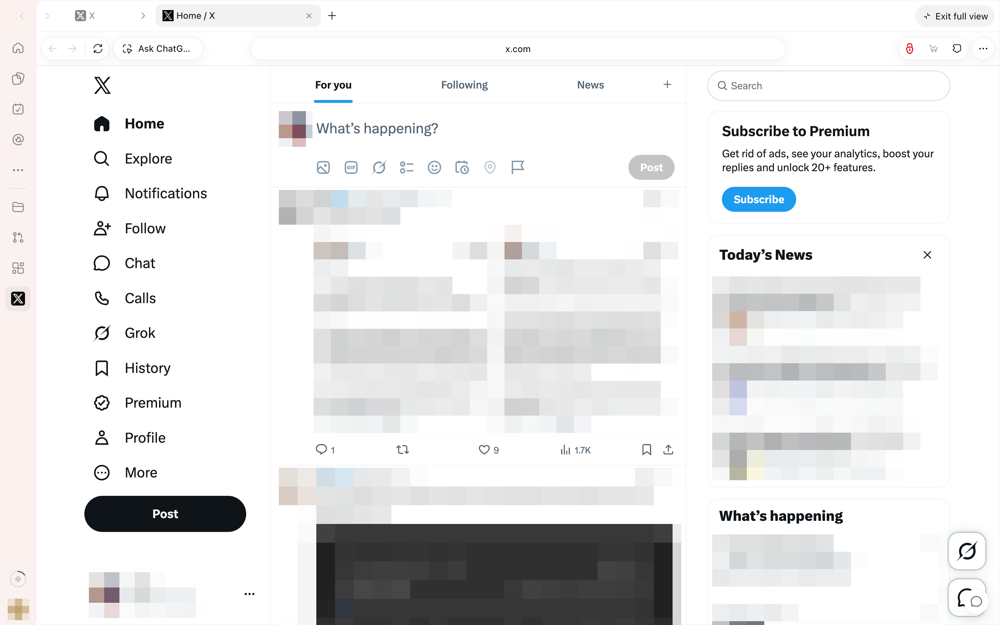

<h1 align="center">Codex X Launcher</h1>

<p align="center"><a href="README.md">English</a> · <strong>简体中文</strong></p>

<p align="center">
  <a href="https://github.com/yuanxiangxie/codex-x-launcher/stargazers"></a>
  <a href="LICENSE"></a>
  <a href="https://github.com/yuanxiangxie/codex-x-launcher/commits/master/"></a>
  <a href="#一快速开始"></a>
  <a href="#一快速开始"></a>
  <a href="https://github.com/yuanxiangxie/codex-x-launcher/pulls"></a>
</p>

<p align="center">
  <a href="resources/x-bar.png"></a>
</p>

Codex X Launcher是一个开源项目，旨在让用户可以在等待agent工作的时间间隙使用x浏览各种信息资源，例如tibo是否重置等。

## 一、快速开始

### 1.1 依赖安装

依赖 Git、Node.js 22 或更高版本及 npm。macOS 版 Codex 需支持侧栏插件和内置浏览器, 目前可支持的Codex版本为26.1120.50957，其余版本未经严格测试，理论上都是可行的。

```sh
git clone https://github.com/yuanxiangxie/codex-x-launcher.git
cd codex-x-launcher
npm ci
npm run build
codex plugin marketplace add "$PWD"
codex plugin add x-launcher@codex-x-launcher
```


<details>
<summary>命令行找不到插件命令？</summary>

如果 Codex 自带的 CLI 位于下方路径，可以在当前终端使用它。帮助信息中应列出 `add` 和 `marketplace`。

```sh
codex() { "/Applications/ChatGPT.app/Contents/Resources/codex-cli/bin/codex" "$@"; }
codex plugin --help
```

</details>

### 1.2 侧栏固定

| 打开 X | 固定到侧栏（可选） |
| --- | --- |
| **Customize → Plugins → Installed → X → Open plugin** | 在插件页面选择 **⋯ → Pin to sidebar**。 |
| [](resources/x-plugin.png) | [](resources/x-plugin-sidebar.png) |

## 二、具体使用

点击侧栏的 **X** 打开 [x.com](https://x.com/)，像浏览器访问**X**一样进行登录，之后正常使用即可。

### 2.1 全屏浏览

1. 点击浏览器面板右上角的 **Enter full view**，或按 <kbd>⇧</kbd> + <kbd>⌘</kbd> + <kbd>F</kbd>。
2. 点击 **Exit full view** 返回分屏。
3. 若菜单中有 **⋯ → Hide composer**，可用它隐藏聊天输入框（建议隐藏聊天输入框）。

[](resources/x-fullview.png)

## 三、工作原理

启动卡片显示时，本地 MCP 工具将固定地址 `https://x.com/` 交给 Codex，由内置的 **Chromium** 浏览器加载页面。[启动代码](plugins/x-launcher/open-x.cjs)

你直接在 X 网页上登录，会话 Cookie 由 Codex 浏览器管理。插件不会读取密码、Cookie、私信或时间线内容。如果你让 Codex 操作网页，则遵循 [Codex 的浏览器权限设置](https://developers.openai.com/codex/app/browser)。

## 四、更新卸载

**更新**时，在最初安装插件的仓库目录运行以下命令。若仍显示旧卡片，重新加载 Codex 窗口。

```sh
git pull --ff-only
npm ci
npm run build
codex plugin add x-launcher@codex-x-launcher
```

**卸载**

```sh
codex plugin remove x-launcher@codex-x-launcher
codex plugin marketplace remove codex-x-launcher
```


## 五、迁移拓展

在自己的 fork 中修改 [open-x.cjs](plugins/x-launcher/open-x.cjs) 的目标地址。例如下面的写法会打开 Python 文档。

```js
url.searchParams.set("url", "https://docs.python.org/3/");
```

- 给新的[插件](plugins/x-launcher/.codex-plugin/plugin.json)和[插件市场](.agents/plugins/marketplace.json)分别设置独立的 ID，以便与 X 插件并存。在 [.mcp.json](plugins/x-launcher/.mcp.json) 和 [server.cjs](plugins/x-launcher/server.cjs) 中同步修改服务名，为卡片设置独立的资源 URI，并确认 [launcher.js](plugins/x-launcher/launcher.js) 调用的工具名与服务端一致。
- 更新显示名称、按钮文字、[插件图标](plugins/x-launcher/x-icon.png)和[卡片模板](plugins/x-launcher/launcher.html)中的标志，并同步修改[插件测试](scripts/verify.mjs)和[界面测试](scripts/verify-ui.mjs)里的预期地址及文字。

构建后，按 `plugin-name@marketplace-name` 的格式使用新 ID 安装。

## 星标历史

<a href="https://www.star-history.com/?repos=yuanxiangxie%2Fcodex-x-launcher&amp;type=date&amp;legend=top-left">
  <picture>
    <source media="(prefers-color-scheme: dark)" srcset="https://api.star-history.com/image?repos=yuanxiangxie/codex-x-launcher&amp;type=date&amp;theme=dark&amp;legend=top-left">
    
  </picture>
</a>

## 许可证

本项目采用 [MIT 许可证](LICENSE)，允许商用、修改和再分发，须保留版权声明和许可声明。
